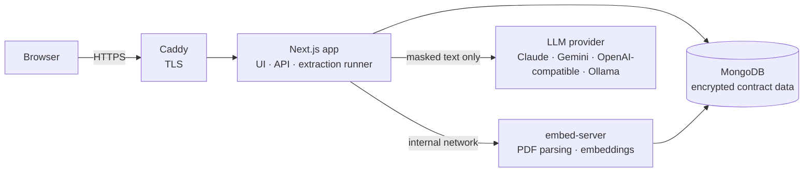

# ContractConsel

**AI-assisted contract review for legal teams.** Upload a contract, list the terms you care about, and get every finding back with a verbatim quote and page citation you can check in one click — combining fast static search with LLM extraction, so you pay for model tokens only where they matter.

Self-hosted, multi-user, and built for confidential documents: contract data is encrypted at rest, personal identifiers are masked before any text reaches an LLM, and every access is audited.

---

## Contents

- [Features](#features)
- [How it works](#how-it-works)
- [Security and privacy](#security-and-privacy)
- [Tech stack](#tech-stack)
- [Getting started (local development)](#getting-started-local-development)
- [Deployment](#deployment)
- [Configuration](#configuration)
- [Choosing an LLM](#choosing-an-llm)
- [Operations](#operations)
- [Project structure](#project-structure)
- [Limitations](#limitations)

---

## Features

**Review**
- **Targeted extraction.** Define the data points you need (e.g. *Governing Law*, *Indemnity Cap*, *Termination for Convenience*), each with optional guidance and keywords. Quick-add presets cover common clauses.
- **Two review modes.**
  - *Focused* — keyword (BM25) and semantic search pick the passages relevant to each field; the LLM reads only those. Token cost stays roughly flat as documents grow (74–87% fewer input tokens on 100–200-page documents in our tests).
  - *Thorough* — the LLM reads every page in fixed windows. Chosen automatically for short documents, where search can't narrow things down enough to save anything.
- **Verified citations.** Every finding carries a verbatim quote and page number, checked against the source text. Unverifiable quotes are flagged *Needs review*.
- **Static keyword search.** Instant, free search across the document (phrases, `terminat*` word forms) with page snippets; click to jump, or add a hit to the report as a finding.
- **Ask AI to find.** Natural-language lookup ("assignment clause") using hybrid retrieval over the contract.
- **Side-by-side PDF viewer** with highlighted quotes, page jump and lazy rendering for long documents.
- **Edit, add and delete** findings; failed or interrupted runs resume from the last completed pass.

**Reporting**
- **Exports in PDF, Word and Excel**, styled as a legal review memo: summary of findings, detailed findings with source citations, verification status, confidentiality markings and page numbering.

**Team**
- **Accounts and roles** — *viewer* (read, search, export), *reviewer* (also upload, extract, edit) and *admin* (everything, plus users, sharing, deletion and audit).
- **Private by default.** Users see the contracts they uploaded; admins see all and share individual reports with specific people.
- **Mandatory two-factor authentication** with any authenticator app (QR enrolment at first sign-in).
- **Audit log** of sign-ins, views, exports, edits, sharing and user changes.

---

## How it works



1. **Upload.** The PDF is encrypted and stored in MongoDB (GridFS). The embed server parses it into pages and section-aware passages and computes local MiniLM embeddings — no external API involved.
2. **Configure.** The reviewer lists the fields to extract; live keyword hit counts show how well each keyword locates its clause.
3. **Plan.** In focused mode, each field's passages are ranked by reciprocal-rank fusion of BM25 keyword scores and embedding similarity, then packed into as few LLM calls as fit a token budget.
4. **Extract.** A background runner executes the passes with database leases, so a restart resumes where it stopped. Each call goes through a single LLM gateway that masks personal identifiers, requests schema-constrained JSON, and restores the originals in the result.
5. **Verify.** Quotes are located in the source pages (whitespace- and table-tolerant) and the cited page is corrected if needed.

---

## Security and privacy

| Control | Implementation |
|---|---|
| Encryption at rest | AES-256-GCM, application-level, for PDFs, page text, passages, findings and filenames (`lib/crypto/content.ts`). Protects the database and its backups; the key never leaves the application host. |
| PII masking | Emails, phone numbers, PAN, Aadhaar, GSTIN, IFSC, bank accounts, cards, UPI IDs and passport numbers are replaced with placeholders before any LLM call and restored afterwards (`lib/privacy/mask.ts`). Checksums (Luhn, Verhoeff) and labels keep false positives low; party names and amounts are deliberately left intact. |
| Authentication | bcrypt passwords, signed HTTP-only session cookies, mandatory TOTP 2FA with replay protection, login throttling. |
| Authorization | Every API route re-checks the user and role on each request; disabling a user, changing a password or resetting 2FA ends their sessions immediately. Reports the user may not see return 404. |
| Audit | Append-only log retained for 400 days. Contract text, filenames and search terms are never logged. |
| Transport | HTTPS via Caddy with automatic certificates; HSTS and hardened security headers; API responses are never cached. The embed server has no public port. |

> **Choose your LLM provider with your confidentiality obligations in mind.** Masking removes identifiers, but contract text is still sent to the provider. Use a paid tier that does not train on API data, or a local model via Ollama.

---

## Tech stack

- **App:** Next.js 16 (App Router), React 19, TypeScript, Tailwind CSS 4
- **Data:** MongoDB (Atlas or self-hosted), GridFS for PDFs
- **Embed server:** Fastify, `pdf-parse`, `@xenova/transformers` (all-MiniLM-L6-v2, 384-dim, runs on CPU)
- **LLM SDKs:** `@anthropic-ai/sdk`, `@google/genai`, `openai` (for OpenAI-compatible endpoints)
- **Exports:** `pdfkit`, `docx`, `exceljs`
- **Hosting:** Docker Compose with Caddy

---

## Getting started (local development)

**Prerequisites:** Node.js 20+, Docker, a MongoDB URI, and an LLM API key (or a local Ollama).

```bash
git clone <repo-url> contract-counsel-ai
cd contract-counsel-ai
npm install

# 1. Configure
cp .env.example .env.local
cp services/embed-server/.env.example services/embed-server/.env
#    Fill in MONGODB_URI, SESSION_SECRET, CONTENT_ENCRYPTION_KEY, LLM_* and
#    EMBED_SERVICE_API_KEY (= API_KEY in the embed server's .env).
#    The embed server also needs MONGODB_URI, MONGODB_DB and CONTENT_ENCRYPTION_KEY.

# 2. First admin
npm run hash-password 'a-strong-password'   # paste ADMIN_EMAIL / ADMIN_PASSWORD_HASH into .env.local

# 3. Run the embed server (PDF parsing + embeddings) on :8080 (PORT in its .env)
cd services/embed-server && docker compose up -d --build && cd ../..

# 4. Run the app
npm run dev    # http://localhost:3000
```

Sign in with the admin credentials, enrol your authenticator app when prompted, then add users under **Admin**.

---

## Deployment

The repository ships a production stack: Caddy (TLS) → Next.js app → embed server, all on one host.

```bash
cp .env.example .env                                  # app settings, incl. APP_DOMAIN
cp services/embed-server/.env.example services/embed-server/.env
docker compose up -d --build
```

Requirements:
- A DNS **A record** for `APP_DOMAIN` pointing at the host, and ports **80/443** open (host firewall and any cloud security list). Caddy obtains and renews the certificate automatically.
- About 6 GB of RAM headroom (embed server 4 GB limit, app 2 GB). 2+ CPU cores recommended.
- The app runs as a **long-running Node server**: extraction is an in-process background job. Serverless platforms that freeze functions after the response (e.g. Vercel) are not supported.

Update a running deployment:

```bash
docker compose up -d --build app            # or embed-server
docker compose logs -f app
```

> Test changes on a staging pair first: run a second app/embed-server with `MONGODB_DB=<name>_staging` on a loopback port, so production users and data are untouched.

---

## Configuration

App (`.env`); see `.env.example` for generation commands.

| Variable | Required | Description |
|---|:-:|---|
| `APP_DOMAIN` | prod | Public hostname served by Caddy |
| `MONGODB_URI` / `MONGODB_DB` | ✓ | Database connection and name |
| `EMBED_SERVICE_URL` / `EMBED_SERVICE_API_KEY` | ✓ | Embed server address and shared key (Compose sets the URL) |
| `LLM_PROVIDER` / `LLM_API_KEY` / `LLM_MODEL` / `LLM_BASE_URL` | ✓ | LLM selection, see below |
| `SESSION_SECRET` | ✓ | 32+ random characters for signing sessions |
| `CONTENT_ENCRYPTION_KEY` | ✓ | 32-byte base64 AES key; **back it up** — losing it makes stored contracts unreadable |
| `PRIVACY_MASK_PII` | | `true` (default) masks identifiers before LLM calls |
| `REQUIRE_2FA` | | `true` (default) requires every account to enrol 2FA |
| `ADMIN_EMAIL` / `ADMIN_PASSWORD_HASH` | first run | Creates the first admin when no users exist |

Embed server (`services/embed-server/.env`): `API_KEY`, `MONGODB_URI`, `MONGODB_DB`, `CONTENT_ENCRYPTION_KEY` (same values as the app), plus tuning knobs `MAX_CONCURRENCY`, `INTERNAL_BATCH`, `FANOUT`, `MAX_UPLOAD_BYTES`. See [`services/embed-server/README.md`](services/embed-server/README.md).

---

## Choosing an LLM

The provider is configuration only — no code changes.

| `LLM_PROVIDER` | Default model | Notes |
|---|---|---|
| `anthropic` | `claude-haiku-5-5` | Low cost; schema-constrained JSON output |
| `gemini` | `gemini-2.5-flash` | Free tier available; use a billed project for client data |
| `openai` | `gpt-4o-mini` | Any OpenAI-compatible API — set `LLM_BASE_URL` (DeepSeek, Groq, OpenRouter, llama.cpp, vLLM…) |
| `ollama` | `llama3.1:8b` | Fully local; no key; needs a GPU for practical speed |

Override the model with `LLM_MODEL`. All providers pass through the same masking gateway (`lib/llm/client.ts`).

---

## Operations

| Task | Command |
|---|---|
| Run tests (PII masking suite, incl. randomised and end-to-end leak tests) | `npm test` |
| Type-check / lint | `npx tsc --noEmit` / `npm run lint` |
| Hash a password for `ADMIN_PASSWORD_HASH` | `npm run hash-password '<password>'` |
| Encrypt data stored before encryption was enabled (idempotent, backs up first) | `BACKUP_DIR=<dir> npm run encrypt-existing [-- --dry-run]` |
| Recover a user locked out of 2FA | Admin → Users → **Reset 2FA** (they re-enrol at next sign-in) |

Backups: rely on your MongoDB provider's backups; they contain only encrypted contract data. Keep `CONTENT_ENCRYPTION_KEY` and `SESSION_SECRET` in a password manager, separate from the database.

---

## Project structure

```
app/                     Next.js routes (pages + API)
  api/auth, api/account  sign-in, 2FA, password
  api/admin              users, audit log
  api/reports            reports, extraction, search, find, export, sharing
components/              UI (workbench, PDF viewer, admin, account…)
lib/
  auth/                  users, sessions, TOTP, guards, rate limiting
  crypto/                encryption at rest
  privacy/               PII masking
  llm/                   provider-agnostic LLM gateway + prompts
  search/                BM25 keyword search, hybrid ranking
  extract/               planner, extractor, background runner, quote verification
  export/                PDF / Word / Excel report builders
  db/                    MongoDB access
services/embed-server/   PDF parsing + embeddings service (Fastify)
deploy/Caddyfile         TLS reverse proxy
tests/                   automated tests
bin/                     maintenance scripts
```

---

## Limitations

- **Scanned PDFs** (images without a text layer) are not yet supported; OCR is planned.
- **Up to 400 pages** per document are read in thorough mode; very large documents should use focused mode.
- Extraction output is an **aid to review, not legal advice** — findings must be confirmed against the source document.
