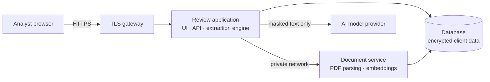

# ContractConsel Platform

**The secure, AI-assisted review platform behind ContractConsel's contract auditing service.**

ContractConsel audits contracts for its clients. This repository contains the proprietary platform our review team uses to do that work: it reads each agreement, extracts the terms that matter, and backs every finding with a verbatim quote and page citation that a reviewer verifies before it reaches the client.

> **Proprietary and confidential.** This is not open-source software and is not offered for self-hosting or licensing. Clients receive audited reports, not access to the platform. The repository is temporarily visible for review by prospective investors; no licence to use, copy, modify or distribute any part of it is granted. © 2026 ContractConsel. All rights reserved. See [LICENSE](LICENSE).

---

## Why it matters

- **Speed.** Hours of manual clause-hunting become minutes: reviewers define what to look for, and the platform finds and cites it across the whole agreement.
- **Accuracy you can check.** Every finding links to the exact passage and page; quotes are verified against the source automatically, and anything unverifiable is flagged for human review.
- **Cost-efficient AI.** A hybrid of fast static search and targeted AI calls means the model only reads the passages that matter. In our tests, input tokens fall by 74–87% on 100–200-page agreements compared with reading the whole document.
- **Built for confidential material.** Client contracts are encrypted at rest, personal identifiers are stripped before any text reaches an AI model, and every access is audited.

---

## Contents

- [Security and privacy at a glance](#security-and-privacy-at-a-glance)
- [Platform capabilities](#platform-capabilities)
- [How it works](#how-it-works)
- [Security and privacy](#security-and-privacy)
- [Technology](#technology)
- [Engineering quality](#engineering-quality)
- [Roadmap](#roadmap)
- [Internal development](#internal-development)

---

## Security and privacy at a glance

Clients trust us with some of their most sensitive documents. The platform is designed around that trust:

- **Encrypted at rest** — client PDFs, extracted text, findings and filenames are AES-256-GCM encrypted before they reach our database. A leaked database or backup is unreadable without our key.
- **Personal identifiers never sent to AI models** — emails, phone numbers, PAN, Aadhaar, GSTIN, IFSC, bank and card numbers, UPI IDs and passport numbers are replaced with placeholders before every model call and restored only inside our infrastructure.
- **Minimal data egress** — document parsing, search and embeddings run on our own servers; only masked passages are sent to the AI provider.
- **Need-to-know access** — each contract is visible only to the analyst who uploaded it and to colleagues an administrator explicitly grants access. Roles are enforced on the server for every request.
- **Mandatory two-factor authentication** for every staff account, with single-use codes and throttled sign-in.
- **Complete audit trail** — sign-ins, views, exports, edits, sharing and account changes are recorded for 400 days, without ever logging contract content.
- **Instant revocation** — disabling an account or resetting its credentials ends its sessions on the very next request.

---

## Platform capabilities

**Review workflow**
- **Targeted extraction** of the terms each engagement needs (e.g. governing law, liability caps, termination rights, renewal terms), with reviewer guidance and keywords per term.
- **Two review modes.** *Focused* — keyword (BM25) and semantic search select the relevant passages for each term and the model reads only those. *Thorough* — the model reads every page; chosen automatically for short agreements.
- **Verified citations** with automatic quote matching against the source; unmatched quotes are flagged *Needs review*.
- **Static keyword search** across the agreement with page snippets — instant and free of AI cost — plus natural-language "find" for clauses phrased unexpectedly.
- **Side-by-side document viewer** with highlighted quotes and page navigation; reviewers edit, add or remove findings before delivery.

**Client deliverables**
- **Audit reports in PDF, Word and Excel**, styled as a legal review memorandum: summary of findings, detailed findings with source citations, verification status, confidentiality markings and page numbering.

**Team and governance**
- **Roles** — *viewer*, *reviewer* and *administrator* — with per-report sharing controlled by administrators.
- **Administration console** for staff accounts, two-factor resets and the audit log.

**Model flexibility**
- A provider-agnostic AI layer lets us use Anthropic Claude, Google Gemini, OpenAI-compatible providers or locally hosted models, selected by configuration. Every provider sits behind the same privacy gateway.

---

## How it works



1. **Intake.** An analyst uploads the client's agreement. It is encrypted before storage and visible only to that analyst until shared.
2. **Processing.** Our document service extracts the text, splits it into section-aware passages and computes embeddings locally — no third party sees the document.
3. **Scoping.** The analyst lists the terms to audit; live keyword hit counts show how well each term is located.
4. **Planning.** For each term, passages are ranked by combining keyword relevance (BM25) with semantic similarity, then packed into as few AI calls as a token budget allows.
5. **Extraction.** A resilient background engine runs the calls. Every call passes through a single privacy gateway that masks personal identifiers, requests structured output, and restores the originals on our side.
6. **Verification and delivery.** Quotes are matched against the source, the analyst reviews and edits the findings, and the audit report is exported for the client.

---

## Security and privacy

### What leaves our infrastructure

| Destination | What is sent | What is never sent |
|---|---|---|
| **AI model provider** (the only external processing) | Passages relevant to the requested terms, with personal identifiers replaced by placeholders; the term definitions | Whole documents, filenames, unmasked identifiers, staff or client account data, credentials |
| **Database** | Encrypted documents, text, findings and filenames; staff accounts; audit log; embedding vectors | Plaintext contract content, plaintext passwords, encryption keys |
| **Anything else** | — | Nothing: parsing, search and embeddings run on our servers, and framework telemetry is disabled |

### Controls

| Area | What it does | Protects against |
|---|---|---|
| **Encryption at rest** | AES-256-GCM with a random IV per value, applied by the application before data is written | Database, snapshot or backup exposure |
| **Identifier masking** | Detects emails, phone numbers, PAN, Aadhaar, GSTIN, IFSC, bank accounts, cards, UPI IDs and passport numbers (with checksum validation such as Luhn and Verhoeff) and replaces them before any AI call | Personal data being retained, logged or used for training by an AI provider |
| **Authentication** | bcrypt-hashed passwords (12+ characters), signed HTTP-only secure cookies, mandatory TOTP two-factor authentication with single-use codes, forced password change for new accounts | Stolen or guessed passwords, replayed codes |
| **Brute-force protection** | Sign-in and two-factor attempts are throttled | Password and code guessing |
| **Authorization** | Every API request re-validates the account, role and session version; contracts are visible only to their uploader, explicitly granted colleagues and administrators; others receive "not found" | Privilege escalation; access to other engagements' documents |
| **Session revocation** | Disabling an account, changing its password or role, or resetting its 2FA invalidates existing sessions immediately | Lingering access after staff changes or a lost device |
| **Audit trail** | Sign-ins and failures, views, document opens, exports, searches, AI queries, extractions, edits, sharing and account administration, with user, time and IP; retained 400 days | Undetected misuse; supports client and regulatory accountability |
| **Log hygiene** | Logs record identifiers and counts only — never contract text, filenames or search terms | Sensitive data spreading into logs |
| **Network isolation** | Only the TLS gateway is publicly reachable; internal services run on a private network with no public ports | Direct access to internal services |
| **Transport and browser hardening** | HTTPS everywhere with HSTS; anti-framing, no-sniff and strict referrer policies; API responses are never cached | Interception, clickjacking, sensitive data in caches |

### Current practices

- Two-factor authentication and identifier masking are enabled for all production use.
- The production database account is least-privilege: it cannot drop or administer databases.
- Only HTTPS (and administrative SSH) is exposed on production hosts.
- Changes are validated on an isolated staging environment with its own database before reaching production.

### Hardening roadmap

We state current limits plainly:
- Masking removes personal *identifiers*; party names, amounts and clause wording are still processed by the AI provider because the review depends on them. We are moving production AI traffic to provider agreements with **no training on our data and zero data retention**, and support fully local models for the most sensitive engagements.
- Restricting database network access to production hosts only, and automated rotation of the content encryption key.
- Embedding vectors and term definitions are stored unencrypted (they contain no contract text); encrypting them is planned.
- Single sign-on (SAML/OIDC) and per-client data-retention policies.

### Reporting a vulnerability

Please report security concerns privately to the ContractConsel team rather than opening a public issue.

---

## Technology

| Layer | Technology |
|---|---|
| Application | Next.js 16, React 19, TypeScript, Tailwind CSS 4 |
| Data | MongoDB with GridFS for documents; application-level AES-256-GCM encryption |
| Document service | Fastify, pdf-parse, all-MiniLM-L6-v2 embeddings on CPU |
| Search | BM25 keyword search with phrase and prefix matching, reciprocal-rank fusion with embeddings |
| AI | Provider-agnostic gateway (Anthropic, Google, OpenAI-compatible, local models) with structured outputs |
| Reports | pdfkit, docx, exceljs |
| Infrastructure | Docker Compose, Caddy (automatic TLS) |

---

## Engineering quality

- **Privacy test suite** — 95 automated tests for identifier masking, including 2,000-document randomised round-trips and an end-to-end test proving no identifiers reach the AI provider (`npm test`).
- **Staging validation** — authentication, authorization and data-separation flows are verified end to end, through the API and in a real browser, on an isolated environment before release.
- **Strict typing and linting** across the codebase.
- **Resilience** — extraction and document processing resume automatically after a restart.

---

## Roadmap

- **Review playbooks** — saved term sets per contract type (MSA, NDA, SaaS, lease, employment).
- **Risk scoring against client standards** — each finding rated against the client's position with a written rationale.
- **Missing-clause detection** — flag expected protections that are absent.
- **OCR** for scanned agreements.
- **Portfolio view and key-date tracking** — renewal and notice deadlines across a client's contract base.
- **Version comparison** — clause-level differences between drafts.

---

## Internal development

For the ContractConsel engineering team only.

```bash
npm install
cp .env.example .env.local        # see comments in .env.example
npm run dev                        # application on http://localhost:3000
npm test                           # privacy test suite
```

Production runs with `docker compose up -d --build` (application, document service and TLS gateway). Configuration, secrets handling and operational procedures are documented internally. The document service has its own notes in [`services/embed-server/README.md`](services/embed-server/README.md).

```
app/                     routes: pages and API (auth, account, admin, reports)
components/              user interface
lib/
  auth/                  accounts, sessions, two-factor, authorization, throttling
  crypto/                encryption at rest
  privacy/               identifier masking
  llm/                   AI provider gateway and prompts
  search/                keyword search and hybrid ranking
  extract/               planning, extraction engine, quote verification
  export/                PDF, Word and Excel report builders
  db/                    data access
services/embed-server/   document processing service
tests/                   automated tests
```

---

© 2026 ContractConsel. All rights reserved. Proprietary and confidential.
